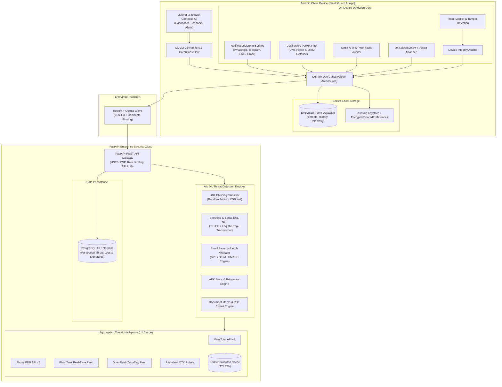
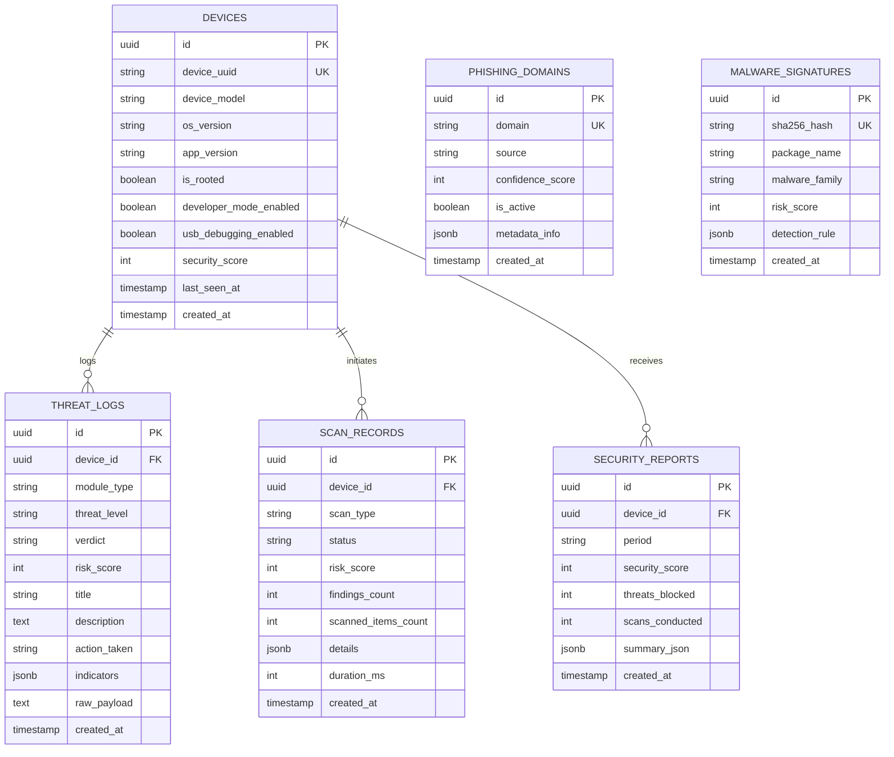

# ShieldGuard AI - Enterprise Cybersecurity Platform
## System Architecture & Technical Specifications

---

## 1. System Architecture Diagram



---

## 2. Database Entity-Relationship (ER) Diagram



---

## 3. OWASP Mobile Top 10 Mitigation Matrix

| OWASP Mobile Risk | Attack Vector | ShieldGuard AI Countermeasure |
|---|---|---|
| **M1: Improper Credential Usage** | Stolen hardcoded API keys | Keystore-backed `EncryptedSharedPreferences`, dynamic HMAC payload signing. |
| **M2: Inadequate Supply Chain Security** | Malicious third-party dependencies | Dependency vulnerability scanning, strict multi-stage docker builds. |
| **M3: Insecure Authentication / Authorization** | Device impersonation / unauthorized queries | Device UUID cryptographically bound to token, strict server API validation. |
| **M4: Insufficient Input/Output Validation** | Malicious intent injection & path traversal | Strict Pydantic v2 data schemas, sanitized file paths, URI validation. |
| **M5: Insecure Communication** | Man-in-the-Middle (MITM) & SSL Stripping | OkHttp `CertificatePinner`, strict TLS 1.3, ARP anomaly detection, VPN DNS guard. |
| **M6: Inadequate Privacy Controls** | Leaking sensitive user notifications | On-device NLP preprocessing; raw chat notifications never sent to server. |
| **M7: Insufficient Binary Protection** | Reverse engineering, Frida tampering | ProGuard / R8 bytecode obfuscation, `RootDetectionEngine` detecting Frida/Magisk. |
| **M8: Security Misconfiguration** | ADB, USB debugging, Unknown Sources | `DeviceIntegrityAuditor` continuous audit with dynamic security score penalty. |
| **M9: Insecure Data Storage** | World-readable database storage | SQLite/Room cipher encryption, internal private app storage only. |
| **M10: Insufficient Cryptography** | Weak SHA-1 or MD5 algorithms | AES-256-GCM, SHA-256 signatures, RSA-4096 / ECC certificate verification. |

---

## 4. Threat Intelligence Aggregation Pipeline

1. **Client URL Interception**: Intercepted from SMS, WhatsApp, Telegram, or Safe Browser.
2. **Local Bloom Filter / LRU Check**: Checked locally against common high-risk signatures.
3. **Backend Redis L1 Cache Lookup**: Immediate sub-millisecond retrieval of cached reputation.
4. **Asynchronous Multi-Source Fanout**:
   - **OpenPhish**: Checks live zero-day active phishing URLs.
   - **PhishTank**: Queries community-verified phishing lists.
   - **VirusTotal v3**: Retrieves multi-vendor malware and malicious URL consensus.
   - **AbuseIPDB v2**: Inspects domain registrar IP abuse confidence score.
   - **AlienVault OTX**: Matches threat pulses and known adversarial infrastructure.
5. **Ensemble Risk Aggregation**: Blends threat feeds with the on-premise XGBoost lexical classifier.

---

## 5. Deployment Guide

### A. Backend Containerized Deployment
```bash
# 1. Clone repository & configure environment variables
cp .env.example .env
nano .env

# 2. Build & launch stack with Docker Compose
docker compose up -d --build

# 3. Verify healthcheck status
curl http://localhost:8000/health
```

### B. Production Kubernetes Deployment
A production deployment should utilize horizontal pod autoscalers (HPA) targeting 70% CPU/Memory utilization, backed by AWS RDS PostgreSQL and AWS ElastiCache Redis.

### C. Android Release Build & Signing
```bash
cd android

# Generate production signed bundle
./gradlew bundleRelease

# Verify ProGuard R8 obfuscation
./gradlew checkReleaseDuplicateClasses
```
