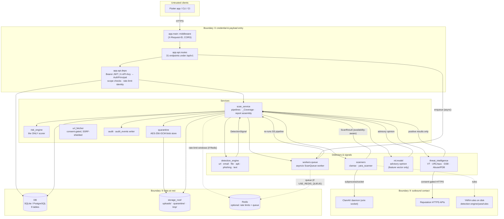

# Architecture diagram

Component map of the single-process deployment (the documented default). Dashed
boxes are the trust boundaries numbered in the
[threat model](../threat-model/README.md). Solid lines are the request/data
paths; the scanning pipeline runs **once** and is shared by sync routes and the
async worker.

Key invariants the diagram encodes:

1. The API layer and the worker call the **same** `scan_service` entry points —
   there is one pipeline, two trigger paths (see
   [request-lifecycle.md](request-lifecycle.md)).
2. Detectors and scanners **emit signals**; only `risk_engine.assess_risk`
   scores. The arrows into the scan service are signal-producing, not
   score-producing.
3. Outbound contact (boundary ③) is consent-gated and, for URL fetch,
   defended by the seven-layer SSRF shield —
   [security-controls.md](../architecture/security-controls.md#ssrf-protection).
4. Storage keys are server-generated; client filenames never reach the
   filesystem path (boundary ④ merges into ② visually) —
   [security-controls.md](../architecture/security-controls.md#path-and-filename-sanitisation).
5. Redis is *optional*; without it, rate limiting and the queue are in-process
   best-effort (report `rate_limiter.degraded: true`).

Related: [project-report/README.md](../project-report/README.md),
[../architecture/README.md](../architecture/README.md).