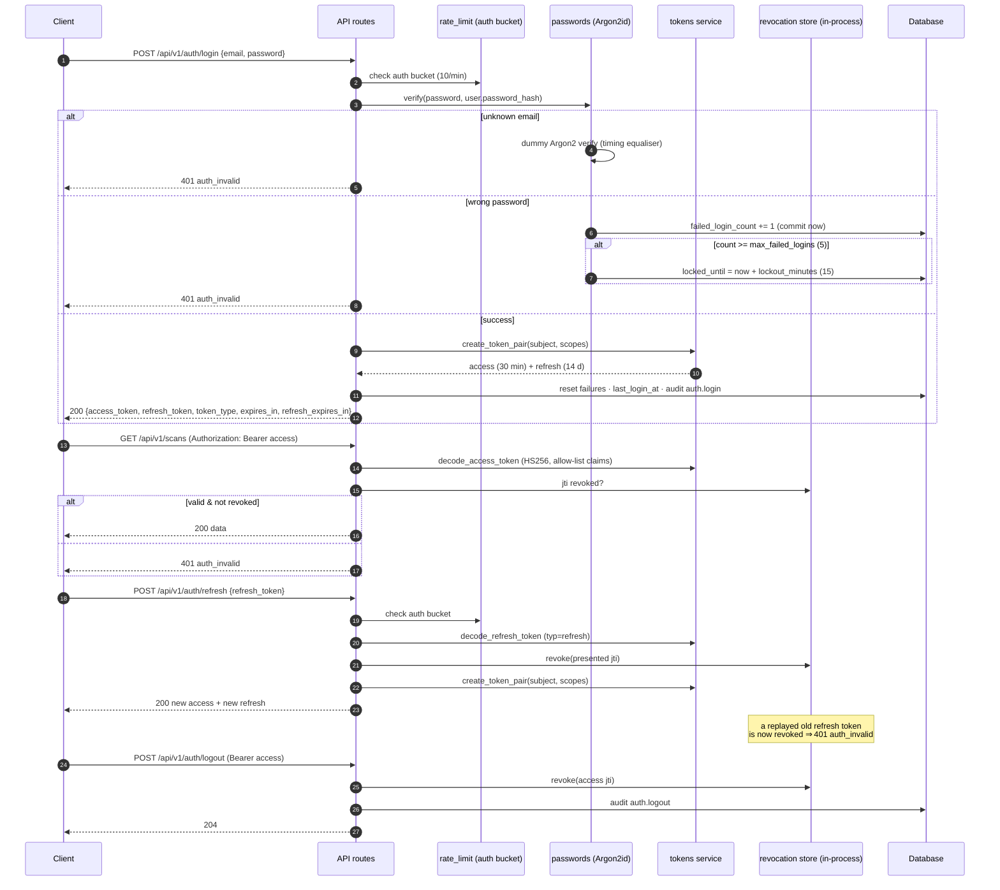

# Auth flow: login, token rotation, logout

Stateless JWT session management with a **best-effort, in-process** revocation
store (`jti` mapping, bounded at 50k entries). Details and code:
[security-controls.md](../architecture/security-controls.md#tokens) and
[../api/auth.md](../api/auth.md).

Notes that matter for the diagram:

- Access and refresh tokens are **typed** and not interchangeable — a leaked
  refresh token cannot be presented as an access token.
- `change-password` revokes the access token presented in that request (the
  store never sees the others — a documented gap, see
  [limitations-and-non-guarantees.md](../project-report/limitations-and-non-guarantees.md)).
- Revocation is per-process: replica B does not see replica A's stores.
  Multi-replica deployments needing cluster-wide rotation should back this
  store with shared state.
- Login without any credential → `401 auth_required`; token verification errors
  never distinguish "expired" from "bad signature" in the message.

Related: [auth-flow](../api/auth.md) API reference,
[token design](../architecture/security-controls.md#tokens).