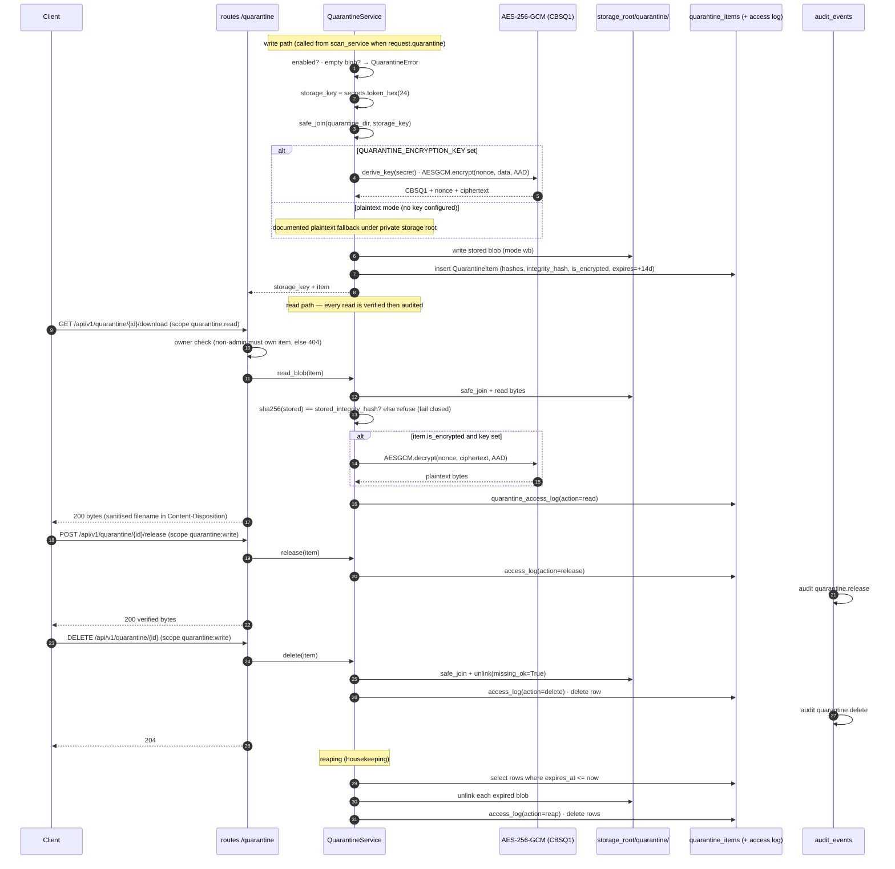

# Quarantine flow

Quarantine is **evidence storage, not execution**: bytes are written once
under an opaque server-generated key, read only through an integrity check
(SHA-256 over the stored blob), optionally AES-256-GCM-encrypted at rest, and
reaped after the retention window. Every byte read/release/delete is audited.
Code: `app/services/quarantine.py` and `app/api/routes/quarantine.py`.

Diagrams the guarantees in words:

- The **client filename never becomes a path**: `storage_key` is generated by
  the server and every access re-checks `safe_join` containment.
- A blob modified outside this service fails the stored-SHA256 check **before**
  decryption (fail-closed); an encrypted blob with no key configured is refused,
  never plaintext-degraded.
- `quarantine:read` governs download; `quarantine:write` governs release and
  delete; both require ownership unless the principal is an administrator.

Related: [../api/quarantine.md](../api/quarantine.md),
[security-controls](../architecture/security-controls.md#quarantine-encryption),
[limitations-and-non-guarantees](../project-report/limitations-and-non-guarantees.md#5-quarantine-is-best-effort-evidence-storage-not-a-security-sandbox).