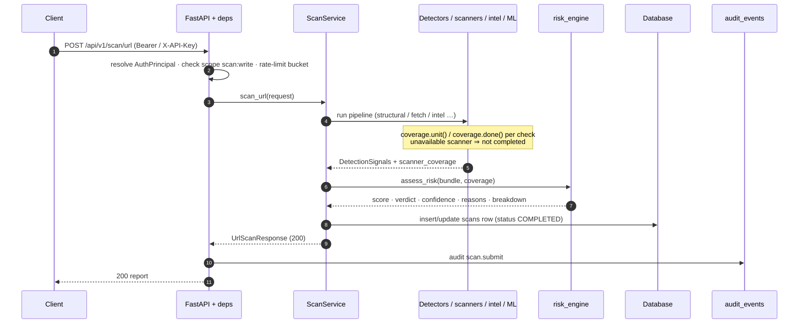
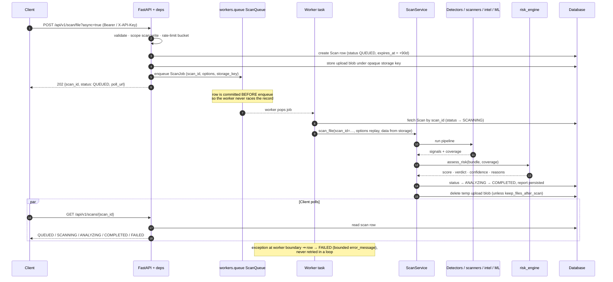

# Request lifecycle: synchronous vs asynchronous scans

Both flows run the **same** `ScanService` pipeline
([detection-methodology.md](../project-report/detection-methodology.md)); they
differ only in *when* and *by whom* it runs, and in what the client sees first.
Status transitions for async scans: `QUEUED → SCANNING → ANALYZING → COMPLETED`,
with `FAILED` on a worker-caught exception.

## Synchronous (default, `?async=false`)

## Asynchronous (`?async=true`)

The upload blob (files/APKs) is parked under an opaque key in
`storage_root/uploads/` before the `202` is returned; the worker removes it
after the job unless `keep_files_after_scan`.

Note on timeouts in the diagram: a scan that does not complete is reported as
`scan_failed` (`500`) on the sync path; there is no background crash-recovery
loop in the current worker — see
[limitations-and-non-guarantees.md](../project-report/limitations-and-non-guarantees.md).

Related: [../architecture/README.md](../architecture/README.md#request-lifecycles)
and [../api/scans.md](../api/scans.md).